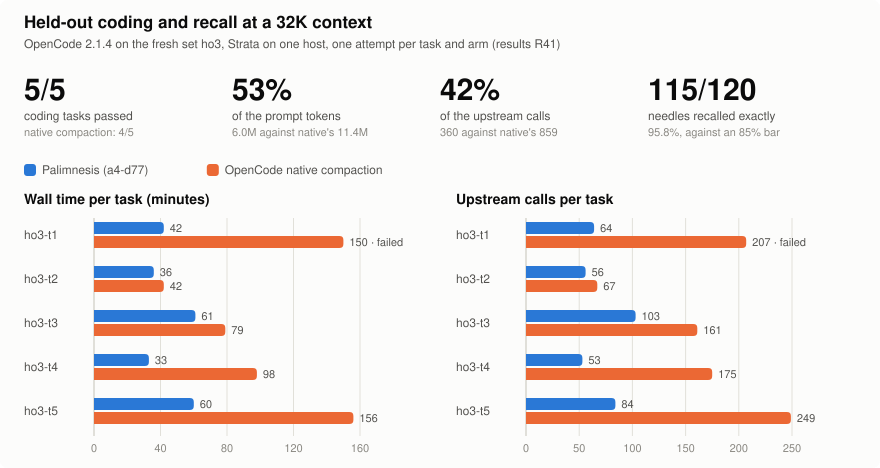

# Palimnesis

A local, lossless context proxy between an agent harness and a [Strata](#requirements) server.

- **Archives** every accepted message exactly, in a local SQLite database.
- **Bounds** what the model sees: when a chat outgrows the context, older turns are masked in the upstream copy only. The harness's own history is never rewritten.
- **Recalls** what the view removed: each new instruction gets a short block of matching archived excerpts, and the full history is published as transcript files the model can grep and read.

Nothing is summarized and nothing is deleted. The model works in a bounded view while the archive keeps the full history.

## Results

<picture>
  <source media="(prefers-color-scheme: dark)" srcset="docs/images/results-dark.svg">
  
</picture>

Held-out set `ho3`, real OpenCode 2.1.4, a local model at 32K, one attempt per task and arm. Details: [R41](docs/results/phase3-acceptance.md#r41--d77-held-out-run-a4-d77-on-ho3-2026-11-0405-pythia-held-out-per-d77); figure drawn by `eval/readme_figures.py`.

## In plain terms

A local model has a small desk. It can only look at so many pages of your conversation at once, and a long coding session soon has more pages than fit.

Most tools handle this by **rewriting old pages into a short summary** and throwing the originals away. The summary is lossy: the exact error message, the file path, the number you mentioned an hour ago are often gone, and the model can't get them back.

Palimnesis does it differently:

- **It keeps every page,** exactly as written, in a filing cabinet on your computer (the archive).
- **It keeps the desk tidy.** When the desk gets full, it takes the oldest pages off the desk, never out of the cabinet. Your tool still has its full copy of the conversation; only what the model is shown changes.
- **It hands back what matters.** Each time you ask something new, it looks through the cabinet and puts the most relevant old snippets on the desk. And it tells the model where the cabinet is, so the model can search it and read any old page word for word.

## The research behind it

Papers motivated the mechanisms; [`docs/contracts.md`](docs/contracts.md) decides behaviour and [`docs/papers.md`](docs/papers.md) lists every adaptation. R and D numbers are entries in [`docs/results/`](docs/results/README.md) and [`docs/decisions/`](docs/decisions/README.md).

| Source | Used for | Outcome |
|---|---|---|
| [The Complexity Trap](https://arxiv.org/abs/2508.21433) | Deterministic masking instead of LLM summaries: stubs for old results, collapsed old turns | Never over budget, every cache change explained. Alone it lost coding tasks (3/5 vs 5/5, R25) because it hid the current turn's own work (R33). Fixed by keeping that turn in view and adding model-written working notes (D70–D72): 5/5 vs 4/5 (R41). |
| [ARC](https://arxiv.org/html/2607.25066v1) | Exact addresses for everything hidden; recall tools called by address | Addressing shipped. The hidden recall tools failed both held-out gates (97/120 needles, 2/5 tasks, R32) and are off by default. |
| [Eunoe](https://github.com/chroxify/eunoe) | Quoting matching history back before each message; transcript files to grep | Shipped. 120/120 held-out recall, 31 of them found only through the transcripts (R25). Quoting the model's own old reasoning hurt coding and was dropped (D71). |
| [LCM](https://arxiv.org/html/2605.04050v1) | Immutable history; optional summary DAG | Append-only archive shipped; DAG not built (optional Phase 5). |
| [RaMem](https://arxiv.org/abs/2606.22844) | Retrieval validity and provenance | Not built yet (optional Phase 6). |

Open problems: the local model sometimes cuts an answer short ("1" for "1.25s"), and later answers in that session copy it (R38, R45; [backlog](docs/backlog.md)). Every held-out result is one attempt per task and arm, so it shows direction, not effect size.

## Requirements

- Python 3.12 and [uv](https://docs.astral.sh/uv/).
- A **Strata 0.1.48** server, or 0.1.54, which D76 verified as an equivalent build, reachable over HTTP. Palimnesis counts tokens exactly as that build does, using a pinned template and tokenizer that ship with it. At startup it checks the server's build, template and a `count_tokens` canary against the pin. On a mismatch it still archives and forwards, but turns bounded views off.
- One harness that speaks OpenAI Chat Completions. **OpenCode 2.1.4** is the supported harness today; see [`docs/harnesses.md`](docs/harnesses.md). Pi and Claude Code are planned.

## Install

```sh
git clone git@github.com:f0ur3y3s/palimnesis.git
cd palimnesis
uv sync
uv run pytest -q   # optional: the full offline suite, no network needed
```

## Quick start (OpenCode)

1. **Run the proxy** against your Strata server:
   ```sh
   uv run palimnesis serve --upstream http://<strata-host>:8080
   ```
   It listens on `127.0.0.1:9000`.
2. **Install the OpenCode integration.** Copy `integrations/opencode/opencode.json` and `integrations/opencode/plugins/palimnesis.ts` into your OpenCode config directory, keeping the `plugins/` folder. Merge the JSON into an existing config rather than replacing it.
3. **Chat normally:** `opencode`, `opencode run …`, `opencode run --session <id> …`.

The plugin routes each OpenCode session to its own Palimnesis session, so new chats and resumed chats need no extra steps. The shipped config also turns off the OpenCode features that would conflict with the proxy. [`docs/harnesses.md`](docs/harnesses.md) explains each setting and what to avoid while using Palimnesis.

## Other OpenAI-compatible clients

Palimnesis needs to know which chat a request belongs to. Get a session base URL and point the client at it:

```sh
uv run palimnesis session new          # prints a base URL for a new chat
uv run palimnesis session url <id>     # the base URL to resume a chat
```

The URL has the form `http://127.0.0.1:9000/s/<session>/v1`. A client that can't change its base URL per chat can send an `X-Palimnesis-Session: <session>` header instead. A request with neither is refused with `session_required`; Palimnesis never merges two chats.

Only `POST /v1/chat/completions` is supported (streaming and non-streaming). `/v1/messages` and `/v1/responses` are refused with `unsupported_feature`.

## Commands

| Command | What it does |
| --- | --- |
| `palimnesis serve --upstream URL` | Run the proxy. |
| `palimnesis session new` / `session url ID` | Base URL for a new or resumed chat. |
| `palimnesis catalog SESSION [--page N]` | Print a session's catalog: what is archived and its addresses. |
| `palimnesis excerpts SESSION` | List the recall excerpt blocks a session has received. |
| `palimnesis transcripts verify SESSION` | Check a session's transcript files against the archive (SHA-256). |
| `palimnesis transcripts rebuild SESSION` | Rebuild them from the archive, byte for byte. |

Prefix each with `uv run`. The inspection commands are read-only and take `--db PATH` for a non-default archive.

### `serve` options

| Option | Default | Meaning |
| --- | --- | --- |
| `--host`, `--port` | `127.0.0.1`, `9000` | Where the proxy listens. |
| `--upstream URL` | (required) | The Strata server's origin. |
| `--db PATH` | see [Where data lives](#where-data-lives) | Archive database. One proxy process owns an archive at a time. |
| `--passthrough` | off | Relay only: no archive, no views, no recall. |
| `--input-budget TOKENS` | 48000 | Cap on the input sent upstream; never above what the server's context allows. |
| `--view on\|off` | `on` | `off` keeps archiving and budget checks but never masks. |
| `--synchronous FULL\|NORMAL` | `FULL` | SQLite durability. `NORMAL` survives process crashes but not power loss. |
| `--transcripts DIR` / `--no-transcripts` | beside the archive | Where transcript files go, or turn them off. |
| `--notes TOKENS` | `2048` | Working notes: before older messages leave the view, one extra upstream call has the model rewrite a notes block that stays in view. `0` turns them off; do so when the input budget is under about 8,000 tokens, where the slot takes too much of the view. |
| `--protect-turn` / `--no-protect-turn` | on | Collapse the current turn's own work last, so the model keeps sight of the steps it just took. |
| `--capture-dir DIR` | off | Store raw request and response bodies, for debugging and replay. **This writes conversation content to disk.** |

`--query-policy`, `--excerpt-renderer`, `--addendum`, `--retrieval`, `--notes-format` and `--notes-header` select variants for evaluation. Their defaults are the configuration the held-out run R41 passed (D43, D78); leave them alone.

## Where data lives

| | Windows | Linux / macOS |
| --- | --- | --- |
| Archive | `%LOCALAPPDATA%\palimnesis\palimnesis.db` | `$XDG_DATA_HOME/palimnesis/palimnesis.db` (default `~/.local/share/…`) |
| Transcript files | `…\palimnesis\transcripts\<session>\` | `…/palimnesis/transcripts/<session>/` |

- **Privacy.** Operational logs never contain message content or credentials. Conversation content is stored only in the archive, the transcript files and, if you turn it on, `--capture-dir`.
- **Transcript files are protected only by filesystem permissions,** which are per-user by default. The model reads them through the harness's own file tools.
- **Deleting.** There is no delete command yet. To discard everything, stop the proxy and delete `palimnesis.db*` and the `transcripts` directory.

## Errors you may see

Errors come back in the client's own error format, with `x-should-retry: false` unless a retry can help.

| Status, code | Meaning | What to do |
| --- | --- | --- |
| 400 `session_required` | The request reached `/v1` without a session. | Use a session base URL, or check that the OpenCode plugin loaded. |
| 400 `session_mismatch` | The URL path and the `X-Palimnesis-Session` header name different sessions. | Fix the client configuration. |
| 400 `invalid_session_id` | A session id outside `[A-Za-z0-9._-]`, or one that doesn't start alphanumeric. | Use an id from `palimnesis session new`. |
| 400 `unsupported_feature` | An endpoint or request feature Palimnesis doesn't support. | See [`docs/capabilities.md`](docs/capabilities.md). |
| 400 `context_budget_exceeded` | The part that can't be masked (system prompt, tool schemas, the current message) doesn't fit. Nothing was archived. | Shorten the input or raise the server's context. |
| 409 `history_divergence` | The client's history no longer matches the archive, after undo, revert, fork or a manual `/compact`. | Start a new chat. |
| 502 `upstream_unreachable` / `upstream_failed` | Strata is down or returned an error. | Check the Strata server. |
| 503 `archive_unavailable` | The archive couldn't commit the request. | Check disk space and that no other proxy owns the database. |
| 504 `deadline_exceeded` | The request ran past its overall time limit. | Retry. Long generations on slow hardware can hit it. |

## Project status

Version 0.1.0, under active development. The plan is [`docs/plan/v1_plan.md`](docs/plan/v1_plan.md), amended by [`docs/plan/amendments/`](docs/plan/amendments/). Each phase's measured results are in [`docs/results/`](docs/results/), and its design decisions in [`docs/decisions/`](docs/decisions/). What the proxy guarantees is stated in [`docs/contracts.md`](docs/contracts.md). Labels such as `a4-d77`, `ho3` or `r2` are explained in [`docs/glossary.md`](docs/glossary.md).

**Known limits.** In the held-out evaluation that accepted Phase 3 (R41, 32K context), the shipped configuration answered 115 of 120 recall questions exactly and succeeded on 5 of 5 long coding tasks, against 4 of 5 for OpenCode's own compaction. Phase 3's first configuration had succeeded on 3 of 5 (R25). That is one attempt per task, one model and one harness; every known limit is listed in [`docs/capabilities.md`](docs/capabilities.md#known-limits-of-phase-3).

**Development tools** are in [`eval/`](eval/):
- `eval/replay.py CAPTURE_DIR --target URL` replays captures against Strata or the proxy.
- `eval/replay.py --explain DB` explains every prompt-cache change between upstream calls.
- `eval/bench_passthrough.py` measures passthrough overhead.

Run each with `uv run python`.

## License

MIT. See [`LICENSE`](LICENSE) and [`THIRD_PARTY_NOTICES.md`](THIRD_PARTY_NOTICES.md).
